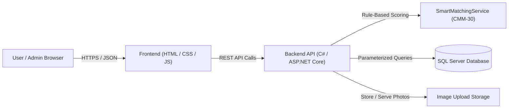
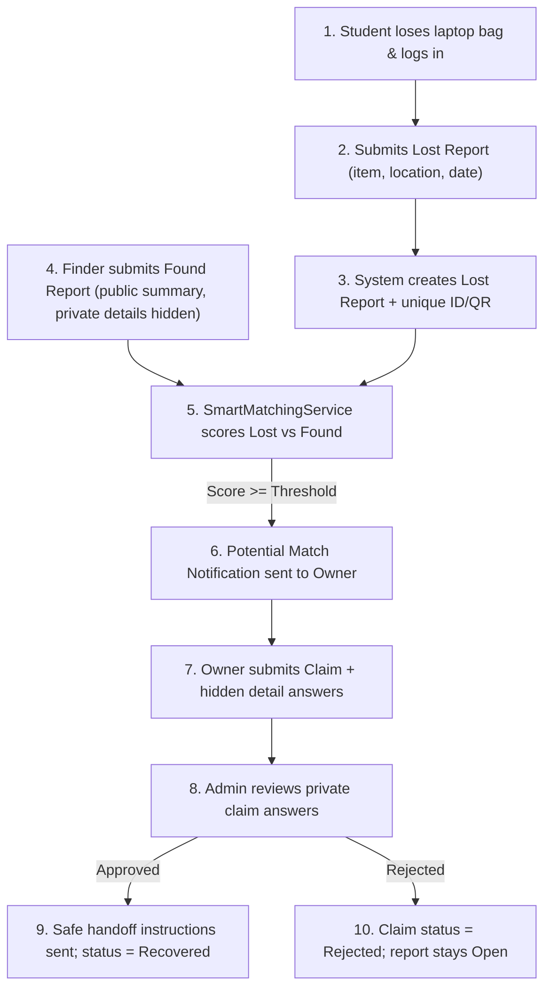
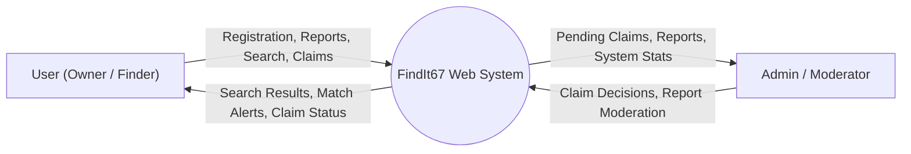
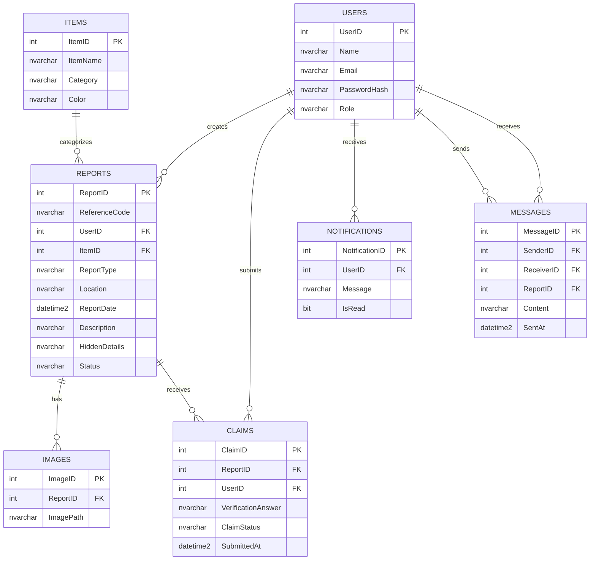

# System Architecture & Diagrams

Covers Jira tasks [`CMM-36`](https://attendance-management-system.atlassian.net/browse/CMM-36), [`CMM-68`](https://attendance-management-system.atlassian.net/browse/CMM-68), [`CMM-69`](https://attendance-management-system.atlassian.net/browse/CMM-69), and [`CMM-70`](https://attendance-management-system.atlassian.net/browse/CMM-70).

---

## 1. Three-Tier Architecture

---

## 2. End-to-End Activity Flow (`CMM-68`)

---

## 3. Data Flow Diagram — Level 0 (`CMM-69`)

---

## 4. Entity-Relationship Diagram (`CMM-69`)

---

## 5. Core Screen Inventory (`CMM-70`)

1. **Home** — Platform overview, quick navigation, and live counters
2. **Login / Register** — Account creation and sign-in
3. **User Dashboard** — Summary of user reports, potential matches, and claims
4. **Report Lost Item** — Lost item form + optional photo & contact preference
5. **Report Found Item** — Public summary fields + private verification clues hidden from public search
6. **Search & Filter Items** — Keyword, report type, category, color, location, and date range filters
7. **Item Details & Match View** — Public item overview, reference/QR code, and candidate smart matches
8. **My Reports** — Manage user's own lost/found submissions
9. **Claims / Recovery Requests** — Submit ownership claim with hidden verification questions
10. **Notifications** — Potential match alerts and claim review status updates
11. **Admin Dashboard** — Moderate reports, manage users/roles, approve/reject claims, and inspect stats (`Open` / `Matched` / `Recovered`)
